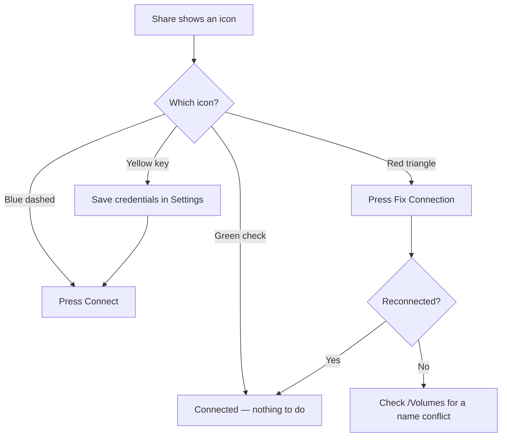

# SMB Connect User Guide

## Overview

SMB Connect connects to SMB shares by IP address while preferring the fastest configured network path.

Typical uses:

- connect to the same storage over `10GbE` when available and `1GbE` when not
- keep several shares ready in one utility
- preload share definitions from JSON or MDM
- let each user store their own password locally in Keychain

## Two Apps To Choose From

SMB Connect comes as two applications. They do the same job and share everything; pick whichever suits you, or use both.

| App | Where it lives | Best when |
|---|---|---|
| **SMB Connect** | Menu bar only, no Dock icon | You want it out of the way and only glance at it |
| **SMB Connect Desktop** | Dock icon and a window | You want a window you can leave open, resize and read properly |

Both show the same shares, use the same settings, and use the same saved passwords. Connect a share in one and the other shows it as connected. You can install one or both, and run both at once.

The **Desktop** app has more room, so it shows the things the menu bar popup has to shorten: the full explanation when another user is holding a volume, every network path configured for a share with the one in use marked, and the complete repair guidance. Its actions are also in menus with keyboard shortcuts — `⌘R` refresh, `⌘K` connect all, `⇧⌘K` disconnect all.

Closing the Desktop app's window does not quit it. It keeps watching your shares and reconnecting them; click its Dock icon to bring the window back. Use **Quit** in its menu to stop it completely.

One note on passwords: the first time the second app connects a share, macOS asks permission to use the saved password. Choose **Always Allow**. This happens once per share.

## How To Use The App

### 1. Open The App

Click the SMB Connect drive icon in the macOS menu bar, or open **SMB Connect Desktop** from your Applications folder or the Dock.

The popover shows:

- a top banner with your current network information, which turns orange to warn you when the Mac is on Wi-Fi with no wired connection
- a `Connection Summary` section
- a `Shares` section with one status card per configured share
- `Refresh` and `Connect All` as the main actions at the bottom
- a row beneath them with `Settings`, `Help`, `Check for Updates`, and `Quit`
- the app version in that same row for a quick peek (also shown, with build number, in the bottom-left of the Settings window)

`Connect All` is highlighted as the primary action. Hover any of the smaller buttons for a description of what it does.

The top banner and the bottom action rows (including `Quit`) stay pinned in place. Only the `Connection Summary` and `Shares` sections scroll, so the title and buttons remain visible no matter how many shares you have configured.

### 2. Read The Connection Summary

The `Connection Summary` section gives a quick count of:

- `Mounted`
- `Preferred`
- `Fallback`
- `Attention`

Below that is a one-line summary per share so you can quickly scan which shares are connected and on what network speed.

### 3. Read A Share Card

Each share card is centered on one configured share alias.

A card shows:

- the share alias
- the SMB share name
- a status icon and a source badge, at the top right
- a `Connection` pill
- a `Status` pill
- a `Network` pill
- a summary line
- a detail line
- an action button such as `Connect`, `Disconnect`, `Fix Connection…`, or `Complete Setup…`

Long share names are shortened with a trailing `…`. Hover the name to see it in full.

#### Status Icon Legend

The icon at the top right of each card is an at-a-glance version of the same state the
`Connection` and `Status` pills spell out below it. Hover any icon to see its wording.

| Icon | Meaning | What to do |
|------|---------|------------|
| ✅ green check | Connected — the share is mounted | Nothing |
| ◌ blue dashed circle | Ready — a network path is reachable and credentials are saved | Press `Connect` |
| 🚫 grey crossed-out Wi-Fi | Not connected — no configured endpoint responded on port 445 | Check the server is on and reachable |
| 🔑 yellow key | Setup needed — no credentials saved for this share | Press `Complete Setup…` |
| ⚠️ red warning triangle | Mounted wrong, or a duplicate mount was found | Press `Fix Connection…` |
| 🛑 red octagon | Blocked — a `/Volumes` name conflict is preventing the mount | See *What To Do For A Volume Name Conflict* |
| 👤 red person badge | Blocked — another user logged in on this Mac has the volume mounted | See *What To Do When Another User Has The Volume* |
| ❌ red cross | Error | Read the detail line beneath the card |

Or follow it through:



#### Source Badge

Beside the status icon, a badge shows where the share's configuration came from:

- `User` — added by you in Settings
- `JSON` — imported from a setup file
- `MDM` — supplied by a managed configuration profile and locked

### 4. Understand The Main Pills

#### Connection

This tells you the broad connection state:

- `Connected`
- `Ready`
- `Blocked`
- `Not Connected`
- `Error`

#### Status

This tells you whether the share is on the expected path:

- `Preferred`
- `Fallback`
- `Fix Needed`
- `Duplicate`
- `Setup`
- `Blocked`
- `In Use`

There may also be a second share-state pill such as:

- `Mounted`
- `Available`
- `Reconnect`
- `Setup Needed`
- `Rename /Volumes Item`
- `Other User`

#### Network

This shows the current or selected network speed for that share, for example:

- `1GbE`
- `10GbE`
- `25GbE`
- `100GbE`

### 5. Use Connect All

The `Connect All` button (`⌘K`) in the footer connects every share that is currently in a ready state — meaning the preferred or fallback network path is reachable and credentials are saved in Keychain.

It is disabled when no shares are connectable (for example, when all shares are already mounted or no network paths are active).

Shares with missing credentials, name conflicts, or duplicate mounts are skipped and must be resolved individually.

## What The Main States Mean

### Connected On Preferred Network

The share is mounted and the app believes it is using the fastest configured preferred path.

### Connected On Fallback Network

The share is mounted, but the preferred path is not active or not selected.

### Preferred Network Available

The share is not mounted yet, but the preferred network path appears reachable and ready.

### Fallback Network Available

The share is not mounted yet, but only a slower fallback path appears available right now.

### Complete Setup

The share definition is present, but the user has not yet saved credentials in Keychain.

### Duplicate Mount Detected

The app has detected multiple mounted instances such as:

- `Video`
- `Video-1`

This is a warning condition and should usually be repaired before continuing work.

Mount detection only looks at genuine network shares mounted under `/Volumes`. macOS system and automounted volumes — such as the `auto_home` map that appears as a non-local volume literally named `home` at `/System/Volumes/Data/home` — are ignored, so a share whose name matches a system volume (for example a share called `Home`) no longer shows a false `Mounted Wrong` or duplicate state.

### Notifications

When a share *newly* enters an attention state — a genuine duplicate, a wrong-path mount, or a `/Volumes` name conflict — SMB Connect posts a single, quiet macOS notification so you are told without having to open the popover. macOS asks for notification permission the first time the app runs; you can change it later in System Settings → Notifications → SMB Connect.

### Volume Name Conflict

The app found a local file or folder in `/Volumes` that already uses the share’s mount name.

Example:

- local folder: `/Volumes/Video`
- intended share mount: `Video`

If the app mounted anyway, macOS could create `Video-1`, which is exactly what SMB Connect is trying to prevent.

### Same Share Mounted Two Ways

A server can be reached by more than one address — its IP, or a Bonjour name such as
`nas._smb._tcp.local` that the Finder's **Network** sidebar uses. macOS has no way to tell
those are the same machine, so mounting the share through both gives you two volumes, the
second suffixed:

```
/Volumes/Storage      from 192.0.2.50               (IP address)
/Volumes/Storage-1    from nas._smb._tcp.local     (Bonjour discovery)
```

This normally happens when a share is mounted once from SMB Connect and once by
double-clicking the server in the Finder sidebar. The card names both addresses and which
kind each is. Use `Fix Connection…` to disconnect every copy and reconnect once on the
configured path, and mount from SMB Connect rather than the Finder sidebar to stop it
coming back.

A single mount from an address that is not one of the share's configured endpoints is
called out too, before it has a chance to duplicate.

### Mounted By Another User

A volume is mounted at a `/Volumes` path once for the whole Mac, not once per user. If a
second person is logged in through fast user switching and has already mounted the share,
that path is taken and macOS would place your copy at `Video-1`.

macOS gives their mount to their account alone — it is `drwx------` under their user ID —
so from your session the folder exists but cannot be opened. Earlier versions of SMB
Connect could not see who owned a mount and reported this as a local folder to rename,
which was impossible advice.

The share card now names the person holding it and whether they are still logged in. For
example:

> Jane Doe (jdoe) has this share mounted at `/Volumes/Video` and is logged in via fast
> user switching. macOS cannot give you that path while they hold it, so connecting now
> would mount Shared Video as `Video-1`.

## Why `-1` Mount Paths Matter

If macOS mounts a share as `Video-1`, applications may record file paths using that full mounted path.

That is especially risky in Final Cut Pro because relinking later can become more difficult if media paths were recorded using a suffixed mount name.

SMB Connect tries to prevent this by:

- warning when duplicate mounts already exist
- blocking connects when a `/Volumes` name conflict would cause a `-1` mount
- offering repair guidance and reconnect workflows

## What To Do For A Volume Name Conflict

If the menu shows `Volume Name Conflict`:

1. Click `Open /Volumes in Finder`.
2. Inspect the conflicting item.
3. Rename or remove the local item that is occupying the intended mount name.
4. Return to SMB Connect and press `Refresh`.
5. Connect again.

If files are already open from that share, quit those apps first.

## What To Do When Another User Has The Volume

If the menu shows `Mounted by Another User`, the fix belongs to whoever holds the mount —
SMB Connect cannot eject another account's volume, and neither can you without admin
rights.

If they are still logged in:

1. Read the card to see who has it and whether they are at the display or switched away.
2. Ask them to eject the volume in the Finder, or switch to their session and eject it.
3. Alternatively, log that user out completely.
4. Return to SMB Connect and press `Refresh`.
5. Connect again.

If the card says they are no longer logged in, the mount was left behind at logout. Press
`Copy Unmount Command` and give the copied line to an admin to run in Terminal:

```bash
sudo umount '/Volumes/Video'
```

Then press `Refresh` and connect again.

`Copy Diagnostics` copies the mount point, the owning account and user ID, their session
state, the server and share behind the mount, and the SMB account they mounted with —
useful when passing the problem to whoever administers the Mac.

To confirm any of this yourself, `mount` in Terminal lists every mount with the account
that made it:

```bash
mount | grep smbfs
```

Each SMB line ends with `mounted by <user>`, which is the same information SMB Connect
now reads directly.

## Wi-Fi Warning

The banner at the top turns orange and reads **Wi-Fi only — no wired network** when your Mac has Wi-Fi but no Ethernet connection.

This is a warning, not an error. Shares mount perfectly well over Wi-Fi — that is exactly why it is worth flagging. Nothing fails, nothing reports an error, and the only symptom is that everything you do on that storage is far slower than it should be. Your shares are configured for a wired `1GbE` or `10GbE` path, and for editing work that path is the one you want.

If you see it, plug in Ethernet and press `Refresh`.

Thunderbolt bridges and VPN tunnels are shown but not judged either way — the app cannot tell a 10GbE Thunderbolt adapter from a tunnel, so it reports the connection and leaves the verdict to you.

## What `Refresh` Does

`Refresh` does four things:

- re-evaluates any MDM managed preferences pushed since the last refresh
- rescans the setup folder for new JSON setup files
- rechecks active local network interfaces and reachability
- refreshes mounted volume and conflict status

Use it after:

- dropping a new setup JSON into the setup folder
- an MDM policy change is pushed to the device
- changing networks
- renaming or removing an item in `/Volumes`
- disconnecting or reconnecting shares outside the app

## In-App Help

You do not need this guide open to get going. SMB Connect has help built in.

Press the `?` button in the menu bar popup, or open **Settings → Help → Getting Started**.
The Help window has two tabs:

- **Quick Start** — adding a share, saving credentials, connecting, and a visual legend
  for the status icons, plus how to make mounting fully automatic.
- **Advanced** — preferred and fallback network paths, shares over VPN, duplicate mounts
  and `-1` paths, volume name conflicts, deploying to many Macs, update checking, and what
  `Refresh` does.

Both tabs link back to this full guide.

## Checking For Updates

SMB Connect can tell you when a newer version has been published.

**On demand** — press `Check for Updates…` in the footer of the menu bar popup. This
always checks and always reports back, including when nothing newer exists. If your copy
is newer than the published release, it says so and names both versions rather than
claiming a match.

**Automatically** — the app also checks quietly when it launches, at most once every 24
hours. This check is silent unless a newer version is found, in which case an alert
offers a `Download` button that opens the release page in your browser.

Nothing is downloaded or installed for you. The check reads only the published version
number and compares it against the running app, and no information about your Mac or your
share configuration is sent.

Pre-release builds are not offered. You will only be told about full releases.

## Settings Window

Open `Settings…` from the menu bar popover.

The Settings window has a left sidebar and a right detail pane.

### Sidebar

The sidebar contains:

- `General`
- `Shares`

The `Shares` list shows each configured share alias, source, and preferred network summary.

### General Section

This contains:

- `Launch at login`
- `Connect all shares on start`
- `Auto-reconnect dropped shares`
- `Setup Folder`
- `Refresh Status`

`Launch at login` registers the app with macOS to open automatically when the user logs in.

`Connect all shares on start` automatically connects every share that is in a ready state after the app finishes its first status check on launch. This works the same as pressing `Connect All` manually — only shares with saved credentials and a reachable network path are attempted. Shares with issues are skipped.

`Auto-reconnect dropped shares` monitors connected shares and automatically reconnects any that drop while the server is still reachable. When a share transitions from mounted to unmounted and SMB Connect can still reach the server on TCP port 445, the app disconnects any stale mount points and reconnects cleanly via the best available network path. A 60-second cooldown per share prevents rapid-fire reconnect attempts if the server is flapping. This is enabled by default.

Pairing `Launch at login` with `Connect all shares on start` and `Auto-reconnect dropped shares` gives a fully automatic mount experience: the app opens at login, connects all ready shares without any user interaction, and keeps them connected if a transient network drop occurs.

`Setup Folder` is where the app looks for setup JSON files on startup and refresh:

`~/Library/Application Support/SMBConnect/Setup`

### Import / Export

This section is for:

- `Import JSON…`
- `Export JSON…`
- `Open Setup Folder`

Use `Import JSON…` to load a setup file manually from anywhere.

Use `Export JSON…` to save the current user-editable share definitions as JSON.

Passwords are not exported.

If you need to create a valid setup JSON file and a matching MDM `.mobileconfig` from a server list, the repo includes a helper script:

- [generate_smbconnect_config.sh](generate_smbconnect_config.sh)

It accepts a comma-separated `.csv` or `.txt` file using:

```text
alias,protocol,shareName,mountName,defaultUsername,note,preferredIP,preferredSpeed,fallbackIP,fallbackSpeed
```

and generates both output formats for SMB Connect.

Examples and usage details are here:

- [Config Generator README](README-config-generator.md)

### Share Settings

This section defines the core share identity.

Fields:

- `Source`
  Admin or config origin, such as user-defined, imported JSON, or MDM-managed.
- `Preferred Network`
  The first-choice network path for this share.
- `Alias`
  The display name shown in the menu bar.
- `Protocol`
  Currently `smb`.
- `Share Name`
  The SMB share path, such as `Outputs` in `smb://server/Outputs`.
- `Mount Name`
  The volume name expected in `/Volumes` after the share is mounted.
- `Default Username`
  A suggested username for the user.
- `Notes`
  Optional comments about the share.

### Network Paths

This section defines one or more IP-based paths to the same share.

Typical use:

- one preferred `10GbE` path
- one fallback `1GbE` path

For each network path, the app shows:

- `Server IP`
- `Network Speed`
- `Priority`
- `Subnet`
- `Label`

Lower priority numbers are preferred first.

**Reachability over VPN.** SMB Connect prefers an endpoint whose `Server IP` is on the same subnet as one of your Mac's local interfaces (your fast local path). If none of those respond, it then tries every other configured endpoint and connects to whichever actually answers on SMB (TCP port 445). This means a share reachable only through a VPN — WireGuard, Tailscale, a corporate tunnel, or a routed/inter-VLAN path — connects normally even though your `utun` address is on a different subnet than the NAS. When a connection is made over such a routed path, the status detail tags it `(via VPN)`, for example `Current network: 1GbE · 198.51.100.50 (via VPN)`, so an over-the-tunnel connection is always visible.

### Credentials

This section stores the user’s login details in Keychain.

Fields:

- `Username`
- `Password`

Actions:

- `Save Credentials`
- `Delete Credentials`

Important:

- passwords are saved locally in Keychain
- passwords are not stored in JSON
- passwords are not stored in the MDM profile

### Current Status

This section shows the live status for the selected share and any repair guidance.

If the share needs repair or attention, this section explains why.

## Ways To Create Configuration

There are several ways to produce share definitions, depending on what you start
from. They all end in one of two artifacts: a **setup JSON** (imported per user
in the app) or an **MDM `.mobileconfig` profile** (pushed by IT).

| Starting point | Tool | Produces |
| --- | --- | --- |
| Typing shares by hand | The app's `Settings…` window | Local config (export to JSON) |
| Shares already mounted on a Mac | **Mount Import Assistant** app, or [`mount_to_smbconnect_config.sh`](mount_to_smbconnect_config.sh) | Setup JSON |
| A spreadsheet / server list | [`generate_smbconnect_config.sh`](generate_smbconnect_config.sh) | Setup JSON **and** `.mobileconfig` |
| An existing setup JSON | [`json_to_mobileconfig.sh`](json_to_mobileconfig.sh) | `.mobileconfig` |

- **In the app** — add and edit shares in `Settings…`, then `Export` to a JSON
  file for backup or to seed another Mac. See `Import / Export` above.
- **Mount Import Assistant** — a small companion app that reads the SMB shares
  already mounted on a Mac and writes a setup JSON, so you can bootstrap a config
  from a machine that is already working. The same workflow is available on the
  command line via `mount_to_smbconnect_config.sh`. See
  [scripts/README-mount-import.md](README-mount-import.md).
- **Generator script** — turn a `.csv`/`.txt` server list into both a setup JSON
  and a matching profile in one step. See
  [scripts/README-config-generator.md](README-config-generator.md).
- **JSON → profile converter** — when you already have a setup JSON and just need
  the deployable MDM profile. See
  [scripts/README-json-to-mobileconfig.md](README-json-to-mobileconfig.md).

## JSON Configuration

SMB Connect can import and export JSON share definitions.

JSON is useful for:

- bootstrapping users
- copying a setup to another Mac
- keeping a backup of share definitions

JSON can define:

- alias
- protocol
- share name
- mount name
- default username
- one or more network paths
- path priority
- notes

Passwords are intentionally omitted.

See:

- [Configuration Format](CONFIGURATION-FORMAT.md)
- [SMBConnectSetup-EXAMPLE.json](examples/SMBConnectSetup-EXAMPLE.json)
- [SMBConnectSetup-DEMO-SIX-SERVERS.json](examples/SMBConnectSetup-DEMO-SIX-SERVERS.json)

## MDM Profile Configuration

SMB Connect also supports an MDM profile that preloads managed share definitions.

This is useful when IT wants to push:

- share aliases
- share names
- mount names
- preferred and fallback IPs
- network speed labels
- default usernames

The user can still enter and store their own password locally in Keychain.

You can build the profile directly from a setup JSON with
[`json_to_mobileconfig.sh`](json_to_mobileconfig.sh):

```bash
./scripts/json_to_mobileconfig.sh \
  -i ./Config/SMBConnectSetup-EXAMPLE.json \
  -o ./Config/generated/SMBConnectSetup-EXAMPLE.mobileconfig \
  --organization "Your Org"
```

Two options shape how the profile behaves on the user's Mac:

- `--allow-user-defined true|false` — with `true` (the default) a deployed
  profile **keeps** each user's own imported shares and merges the managed ones
  on top, so pushing a profile does not wipe a user's existing setup. With
  `false`, the app shows only the managed shares.
- `--blank-username` — leave each managed share's `defaultUsername` empty so
  every user enters their own. Without it, the username from the JSON is baked
  into the profile and is identical (and locked) for all users on the device.

Passwords are never written to the profile.

### Entering Credentials For A Managed Share

A managed share is preloaded read-only, but its username and password are not
part of the profile. To finish setup, open `Settings…`, select the managed
share, and enter the username and password in the `Credentials` section — they
are saved to the user's Keychain and reused on every connect.

> **Requires app v0.5.2 or later.** Earlier builds regenerated a managed share's
> internal identity on every refresh (about every 20 seconds), which reset the
> Settings selection and blanked the credential fields as you typed, and
> prevented saved credentials from being reloaded. v0.5.2 gives managed shares a
> stable identity so credentials can be entered once and persist. If you deployed
> an earlier build, install v0.5.2 and re-enter the credentials once; the profile
> itself does not need to be redeployed.

See:

- [com.matx.SMBConnect.mobileconfig](examples/com.matx.SMBConnect.mobileconfig)
- [scripts/README-json-to-mobileconfig.md](README-json-to-mobileconfig.md)

## Recommended Admin Workflow

1. Create share definitions using one of the methods in
   [Ways To Create Configuration](#ways-to-create-configuration) — type them in
   the app, import existing mounts with the Mount Import Assistant, or generate
   them from a server list.
2. Preload alias, share name, mount name, and preferred/fallback IPs.
3. Optionally preload a default username, or use `--blank-username` so each user
   supplies their own.
4. To deploy by MDM, convert the JSON with
   [`json_to_mobileconfig.sh`](json_to_mobileconfig.sh) (or generate
   the profile directly). Keep `--allow-user-defined true` unless you want to
   lock users to only the managed shares.
5. Let the user open the app and save their password locally in Keychain.
6. Have the user connect from the menu bar app.

## Recommended User Workflow

1. Open SMB Connect from the menu bar.
2. Open `Settings…` if a share shows `Complete Setup`.
3. Save your username and password in the `Credentials` section.
4. Return to the menu bar app.
5. Press `Connect All` to mount all ready shares in one action, or connect individual shares as needed.
6. If warned about duplicate mounts or `/Volumes` conflicts, resolve those before editing media.

To connect automatically on every login, enable both `Launch at login` and `Connect all shares on start` in Settings → General.

## Troubleshooting

### The Share Does Not Connect

Check:

- the configured IP address
- whether the preferred or fallback network is actually active
- whether credentials were saved in Keychain
- whether the target SMB server is reachable

### The App Says `Volume Name Conflict`

There is already a local item in `/Volumes` using the mount name.
Open `/Volumes`, inspect the item, then rename or remove it before connecting.

### The App Says `Same Share Mounted Two Ways`

The share is mounted from two different addresses for the same server — typically its IP
and its Bonjour `.local` name. Use `Fix Connection…`, then mount from SMB Connect rather
than the Finder's Network sidebar.

To see it yourself, `mount` in Terminal shows the address each mount came from:

```bash
mount | grep smbfs
```

### The App Says `Mounted by Another User`

Another account logged in on this Mac holds the `/Volumes` path this share needs. Ask
them to eject it or log them out, then press `Refresh`. If they have already logged out,
an admin can clear the leftover mount with `sudo umount` — the card's `Copy Unmount
Command` button gives you the exact line.

### The App Says `Duplicate Mount Detected`

The share appears mounted more than once.
Use the repair workflow or manually disconnect all matching mounts and reconnect only once.

### The Share Mounted On The Wrong Network

If the app says the share is on a fallback or slower path, use the repair flow to disconnect and reconnect on the preferred network when available.

> **Fixed in v0.5.3.** Earlier builds (v0.5.1 and v0.5.2) could falsely report `Mounted Wrong` or a duplicate for a share whose name matched a macOS system/autofs volume — most commonly a share called `Home`, which collided with the built-in `auto_home` volume named `home` — even though there was no real mount and no `-1` volume in `/Volumes`. v0.5.3 restricts detection to genuine network shares under `/Volumes`. If you saw this, install v0.5.3 and press `Refresh`.

### A Share Keeps Disconnecting And Reconnecting

If a share repeatedly drops and auto-reconnects, the underlying NAS or network path is unstable. SMB Connect enforces a 60-second cooldown between reconnect attempts for the same share to prevent thrashing. Check:

- the physical network connection to the NAS
- whether the NAS is under heavy load or restarting services
- whether a VPN or firewall is intermittently blocking SMB traffic on port 445

If the flapping continues, consider disabling `Auto-reconnect dropped shares` in Settings → General until the network issue is resolved.

### Auto-Reconnect Is Not Triggering

Auto-reconnect only fires when the share transitions from mounted to unmounted while the server is still reachable. It will not trigger if:

- the server itself is down or unreachable (the share shows `Unavailable`, not `Ready`)
- the share was never mounted in the current session (the app must have seen it mounted at least once)
- the 60-second cooldown from a previous reconnect attempt has not elapsed
- `Auto-reconnect dropped shares` is turned off in Settings → General
